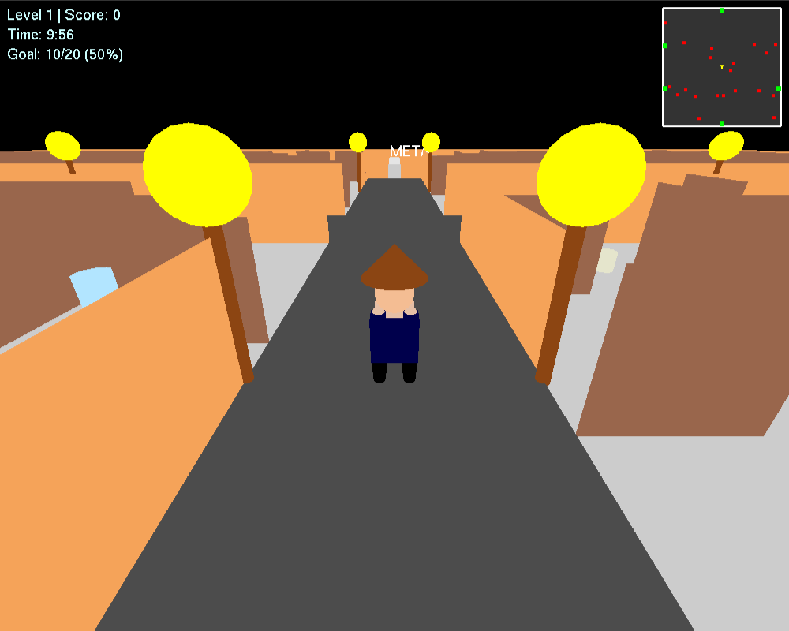

# ♻️ Eco Guardian: A 3D Waste-Sorting Game


A 3D game built from scratch in **Python + OpenGL (immediate mode, GLUT)** that teaches recycling. Explore a walled maze, pick up litter, and drop each item into the correct bin before time runs out. Every level brings more trash, less time and a higher target.

<p align="center">
  
</p>

## 🎮 Gameplay

- **27 trash items in 5 categories**, including everyday Bangladeshi litter like *chanachur packets*, *murir tins* and *mosquito spray cans*:

  | Bin | Examples |
  |---|---|
  | 📄 Paper | newspaper, quiz script, cardboard box, paper cup |
  | 🧴 Plastic | chips packet, shampoo sachet, water bottle, oil container |
  | 🍾 Glass | glass jar, wine bottle, medicine syrup bottle |
  | 🥫 Metal | soft drink can, food can, foil, murir tin |
  | 🍌 Biodegradable | banana peel, coconut shell, fish bones, eggshell |

- **Scoring:** +1 for the right bin and −1 for the wrong one. The score can go negative, so guessing doesn't pay.
- **Progressive levels:**

  | Level | Trash | Time limit | Target |
  |---:|---:|---:|---:|
  | 1 | 20 | 10:00 | 50% |
  | 2 | 25 | 8:00 | 60% |
  | 3 | 30 | 6:00 | 70% |
  | 4 | 35 | 4:00 | 80% |
  | n | 20 + 5(n−1) | max(2:00, 10:00 − 2:00·(n−1)) | 50% + 10%·(n−1) |

  A level ends early if the remaining trash can no longer reach the target.

## ⌨️ Controls

| Key | Action |
|---|---|
| `W` / `S` | Move forward / backward |
| `A` / `D` | Turn left / right |
| `N` | Pick up the trash in front of you |
| `M` | Drop the selected item into the bin in front of you |
| `Tab` | Cycle through inventory |
| `V` | Toggle third-person and first-person camera |
| `↑` `↓` `←` `→` | Adjust camera height and angle (first-person) |
| `R` | Restart after game over |

## 🛠️ Under the Hood

- **Hand-built 3D scene** made from GL primitives: a procedurally generated **maze** with collision detection, a road, street lamps, a hatted player character, and cylinder-on-cube bins.
- **Two camera rigs:** a third-person follow camera and a first-person camera with adjustable yaw and height.
- **Live HUD:** level, score, countdown timer and goal, plus a **top-down minimap** showing the player, trash (red) and bins (green).
- **Smooth movement** from key-down/key-up state tracking instead of key-repeat events.
- **Proximity interaction:** checks which trash item or bin is directly in front of the player.

## 🚀 Run It

```bash
git clone https://github.com/nabilah-hossain-ruba/Eco-Guardian.git
cd Eco-Guardian
python Eco_Guardian_New.py
```

The repo bundles a copy of **PyOpenGL with the freeglut DLLs** in `OpenGL/`, so the game runs on Windows with no extra installs. pip's PyOpenGL doesn't include freeglut on Windows. On Linux and macOS, install the system GLUT package (for example `sudo apt install freeglut3-dev`) and run `pip install -r requirements.txt`.

## 👥 Team

Built by **Nabilah Hossain**, **Muhammad Mujtahid** and **Shanin68** as a course project at BRAC University.
